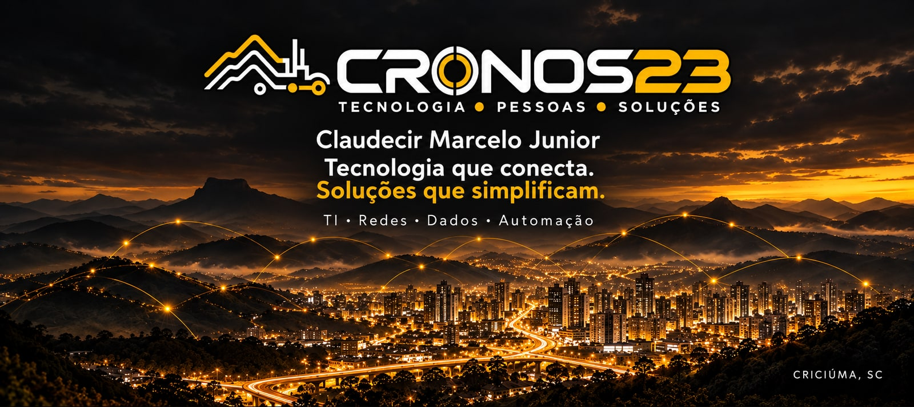

  <a href="https://cronos23-portfolio.jrmarcelo23.chatgpt.site/">
    <picture>
      <source media="(max-width: 600px) and (prefers-reduced-motion: reduce)" srcset="assets/banner-readme-cronos23-mobile-v3.png" />
      <source media="(max-width: 600px)" srcset="assets/banner-readme-cronos23-mobile-v3.gif" />
      <source media="(prefers-reduced-motion: reduce)" srcset="assets/banner-readme-cronos23-gold-v2.png" />
      
    </picture>
  </a>

# Claudecir Marcelo Junior

**Cronos23** · Meu codinome em projetos de tecnologia.

**TI, redes e automação aplicadas a problemas reais.**

Meu foco é simplificar rotinas, organizar informações e desenvolver soluções úteis. Tenho interesse em infraestrutura, segurança defensiva e desenvolvimento de ferramentas que tornem a tecnologia mais acessível no dia a dia.

Tenho 8 anos de experiência em telecomunicações, com atuação em redes, telefonia e internet.

Tenho também 4 anos de experiência em TI na Tecnnic, apoiando processos e usuários no ambiente corporativo.

## Portfólio profissional · Cronos23

<a href="https://cronos23-portfolio.jrmarcelo23.chatgpt.site/">
  <picture>
    <source media="(max-width: 600px)" srcset="assets/portfolio-cronos23-v13-mobile.jpg" />
    
  </picture>
</a>

[**Acesse meu portfólio profissional →**](https://cronos23-portfolio.jrmarcelo23.chatgpt.site/)

Conheça minha atuação em TI, infraestrutura, dados, segurança eletrônica e automação de ambientes, além dos projetos apresentados e canais de contato.

Para facilitar o primeiro contato, o site oferece quatro caminhos por necessidade: conectividade, computadores e continuidade, segurança e automação, e dados. Também inclui respostas a dúvidas frequentes. Os atalhos levam ao formulário, que prepara uma mensagem para a pessoa revisar antes de abrir o WhatsApp; o site não armazena os dados nem envia mensagens automaticamente.

## Conhecimentos e atuação

| Área | Conhecimentos e aplicação |
| :--- | :--- |
| Telecomunicações e redes | Redes físicas, cabeamento, Wi-Fi, telefonia e internet. |
| TI e infraestrutura | Suporte, diagnóstico, formatação de computadores e notebooks, Windows e Windows Server. |
| Backup e continuidade | Veeam, rotinas de backup e recuperação de dados. |
| Segurança eletrônica e automação | CFTV, portões e automação de casas e ambientes. |
| Dados e processos | BI, conexões com bancos de dados, tratamento e organização de informações. |
| Segurança defensiva | Boas práticas, prevenção e análise responsável. |
| Documentação | Instruções, processos, inventários e registros para facilitar a manutenção. |
| Desenvolvimento e comunicação | Apoio no desenvolvimento de ferramentas, automações e materiais de comunicação e marketing. |

Atuação em Criciúma, SC, conectando experiência prática e tecnologia para simplificar o dia a dia.

## Como conduzo meus projetos

- Entender o problema antes de escolher a ferramenta.
- Priorizar clareza, usabilidade e manutenção.
- Validar o que foi implementado e documentar suas limitações.
- Compartilhar apenas conteúdo adequado à divulgação pública.

## Contato

- **E-mail:** [clashcronos23@gmail.com](mailto:clashcronos23@gmail.com)
- **Telefone / WhatsApp:** [+55 (48) 99902-2204](https://wa.me/5548999022204)

## Por aqui

Este espaço reúne meus interesses técnicos e minha evolução em projetos pessoais. Novos trabalhos públicos serão apresentados com contexto, documentação e instruções de uso.

[Organização dos projetos pessoais](docs/ORGANIZACAO-GITHUB.md) · [Modelo para novos projetos](modelos/projeto-pessoal/README.md)

---

Aprender, construir e melhorar — um projeto por vez.

